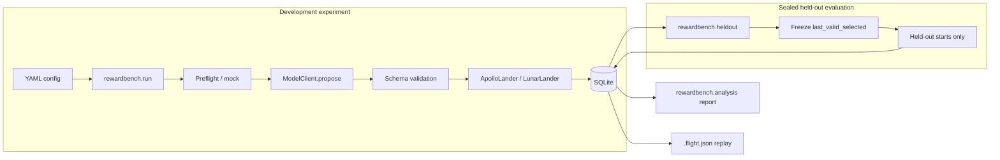
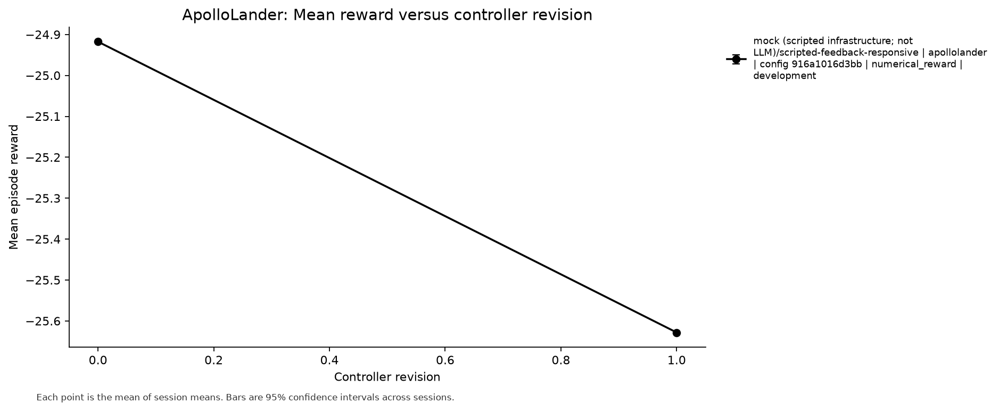
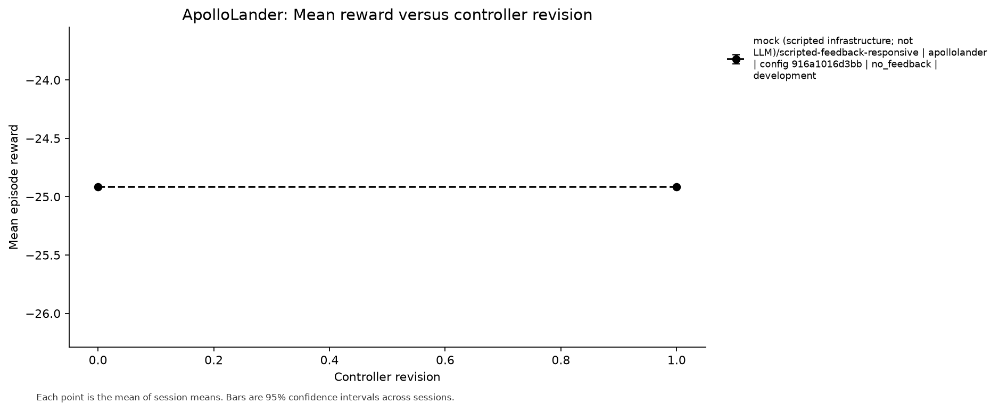

# R.E.A.C.T.

**Reward-Enhanced Adaptive Controller Testing**

R.E.A.C.T. asks a precise question: *when a language model may revise a constrained controller inside a simulator, does seeing numerical rewards change those revisions more than an otherwise identical no-feedback condition?*

Adaptation is **in-context**. Model weights stay fixed. A physics simulator—not another model—assigns the score. Development revisions and sealed held-out evaluation are separate steps.

| | |
| --- | --- |
| Project | **R.E.A.C.T.** |
| Internal package | **`rewardbench`** |
| Status | Engineering / research **prototype** (v1) |
| Validated LLM rankings | **None published** |
| Repository | https://github.com/ManpreetS2/R.E.A.C.T |



## What is proven vs empty

| Slot | Status |
| --- | --- |
| Offline mock numerical vs no-feedback loop | **Proven** (scripted model, real physics) |
| Research-mode development baselines (0/16 / 16/16) | **Proven** (hand-specified / scripted; not LLM) |
| Flight manifests + deterministic replay | **Proven** |
| Freeze → sealed held-out eval (no model call) | **Proven** (offline) |
| Authorized live CLI + spend gates | **Proven** with mocked HTTP |
| Real OpenAI / Gemini / Claude / Grok adaptation results | **Empty** — reserved for future owner-approved runs |
| Independently validated model ranking | **Empty** — not claimed |

Scripted and hand-specified controllers demonstrate the pipeline. They are **not** evidence that a language model learned.

## Architecture

| Layer | Role |
| --- | --- |
| Contracts | `ModelClient`, `EnvironmentAdapter`, budgets, splits (`docs/INTERFACES.md`) |
| Runner | Revisions, episodes, resume, SQLite |
| Environments | Gymnasium LunarLander-v3 · ApolloLander (Seb Lee-Delisle, MIT) |
| Providers | OpenAI · Google Gemini · Anthropic Claude · xAI Grok (+ mock) |
| Held-out | Freeze final selected controller; score sealed starts; never `propose` |
| Analysis | Session stats, figures, markdown reports |

Controller revisions and simulated episodes are different records. Gymnasium and ApolloLander scores are never pooled.

## Experiment workflow

1. **Development** (matched seeds; numerical **or** no-feedback)  
2. **Freeze** the last valid selected controller  
3. **Held-out evaluation** on sealed starts (no model calls; scores never re-enter prompts)  
4. **Report** from SQLite · **Replay** `.flight.json` manifests  

Paired configs share simulator settings and seed lists; only feedback condition (and names/paths) differ.

See [the independent offline v1 audit](docs/OFFLINE_V1_VERIFICATION.md) for the
verified release scope, repairs, exact evidence, and remaining research limits.

## Quick start

Python **3.11+** (3.12 recommended) and Node.js (ApolloLander physics).

```bash
python3.12 -m venv .venv
source .venv/bin/activate
python -m pip install --upgrade pip
python -m pip install -e ".[dev,analysis,environments]"
```

### Tests

```bash
python -m pytest tests -q
node frontend/apollolander/experiment/physics.test.js
```

No API key required.

Repeat the entire offline demonstration twice in fresh databases, verify SQLite,
41 flight replays, and report/figure determinism:

```bash
python examples/verify_offline_v1.py --out runs/offline-v1-verification
```

Use a new output directory on each invocation; existing evidence is preserved.

### Offline demonstration (scripted mock — infrastructure)

```bash
# Matched development arms
python -m rewardbench.run \
  --config configs/apollolander_offline_development_numerical.yaml --mode mock

python -m rewardbench.run \
  --config configs/apollolander_offline_development_nofeedback.yaml --mode mock

# Engineering/demo held-out evaluation (no model calls)
python -m rewardbench.heldout \
  --database runs/apollolander_offline_numerical.sqlite \
  --source-config configs/apollolander_offline_development_numerical.yaml \
  --record-dir runs/heldout-flights/numerical

python -m rewardbench.heldout \
  --database runs/apollolander_offline_nofeedback.sqlite \
  --source-config configs/apollolander_offline_development_nofeedback.yaml \
  --record-dir runs/heldout-flights/nofeedback

# Reports
python -m rewardbench.analysis report \
  --logs runs/apollolander_offline_numerical.sqlite --out reports/offline_numerical

python -m rewardbench.analysis report \
  --logs runs/apollolander_offline_nofeedback.sqlite --out reports/offline_nofeedback
```

See `examples/heldout/README.md` and `docs/DEMO.md`.

### Launch ApolloLander locally

```bash
cd frontend/apollolander
python3 -m http.server 8766
```

Open http://localhost:8766/experiment/index.html

### Example flight replay

Tracked sample (scripted mock; verifies):

`docs/assets/v1-evidence/flights/offline_mock_development_episode.flight.json`

```python
from rewardbench.environments import make_environment

adapter = make_environment("ApolloLander", research_mode=True)
verified = adapter.verify_flight_record(
    "docs/assets/v1-evidence/flights/offline_mock_development_episode.flight.json"
)
assert verified["matched"] is True
```

### Evidence figures (scripted offline mock)





These plots come from real SQLite logs of the **scripted** mock model. They are pipeline evidence, not LLM success.

## Four model providers

| Provider | Typical models | Live path |
| --- | --- | --- |
| OpenAI | e.g. `gpt-5.4-mini` | Authorized CLI + preflight |
| Google | Gemini family | Same contract |
| Anthropic | Claude family | Same contract |
| xAI | Grok family | Same contract |

Pilot template (requires owner spend approval; **do not run casually**):

- `configs/apollolander_pilot_openai_gpt54mini.yaml`
- Companion: `configs/apollolander_pilot_openai_gpt54mini_nofeedback.yaml`

Cost safeguards: explicit `--i-authorize-paid-api-calls`, one new paid `propose` per invocation, `max_model_retries: 0`, software ceiling `$0.05` (**not** a vendor billing guarantee), priced-model preflight, continuation flag for revision 2.

Dry-run without a key:

```bash
python examples/providers/dry_run_first_call.py
```

## Reproducibility

| Item | Value (verified on integration tip) |
| --- | --- |
| Python | 3.12.x |
| Node | 22.x (physics tests) |
| Key packages | PyYAML, pytest, numpy, scipy, matplotlib, gymnasium, imageio |
| Install | `pip install -e ".[dev,analysis,environments]"` |
| Apollo schedule | `apollolander.starts.v1` |
| Apollo env version | `apollolander.env.v1` |
| Offline numerical config | `configs/apollolander_offline_development_numerical.yaml` |
| Offline no-feedback config | `configs/apollolander_offline_development_nofeedback.yaml` |
| Held-out CLI | `python -m rewardbench.heldout ...` |

Pin tip SHA when publishing results. Development and held-out seeds must stay disjoint; held-out scores must never appear in model prompts.

## Testing and cost safeguards

- Full suite: `pytest tests` + Node physics  
- Live mode refuses without explicit authorization  
- Missing credentials / unpriced models / budget misconfig refuse before network use  
- Invalid controllers are not flown  
- No-feedback history withholds numerical rewards from prompts while SQLite still stores them for analysis  
- Held-out tables are additive and unread by development history builders  

## Honest limitations

- The current comparison tests richer simulator feedback versus no feedback: the numerical arm also includes outcome/state metrics. It does not identify the isolated causal effect of scalar reward.
- Average reward change across different research starts alone does **not** prove improvement.  
- Compare revisions on matched development conditions, then score **frozen** final policies on sealed held-out starts.  
- Seeds `1000000–1000007` were used in engineering demos — they are **not** untouched final-evaluation evidence. See `docs/FINAL_EVALUATION_PROTOCOL.md`.  
- This repository currently publishes **no** independently validated LLM ranking.  
- Software spend caps cannot cap a vendor invoice if keys escape process control.  
- Credit economy, competition mode, and Minecraft are **out of scope** for v1.

## Documentation map

| Doc | Contents |
| --- | --- |
| `docs/DEMO.md` | Short technical demonstration plan |
| `docs/FINAL_EVALUATION_PROTOCOL.md` | Burned vs reserved final-eval cohorts |
| `docs/PILOT_CHECKLIST.md` | First paid LLM call checklist |
| `docs/FIRST_EXPERIMENT_PROTOCOL.md` | Paired LLM study protocol (not executed) |
| `docs/INTERFACES.md` | Contracts, SQLite, live + held-out CLI |
| `docs/EXPERIMENTS.md` | Conditions and export |
| `docs/ANALYSIS.md` | Figures and sessions |
| `docs/LIMITATIONS.md` | Leakage and fairness |
| `docs/assets/v1-evidence/` | Tracked figures + sample flight |
| `PLAN.md` | Engineering roadmap (Agent 4) |
| `examples/heldout/README.md` | Freeze / held-out commands |

## Credits

**ApolloLander was created by Seb Lee-Delisle and published under the MIT License.**  
Upstream snapshot `0da09dccbadf0d6ee6efcce1f72e9ae206d341d2`. See `frontend/apollolander/upstream/LICENSE` and `frontend/apollolander/THIRD_PARTY.md`.

## License

R.E.A.C.T. experiment code does not yet include a project-wide license. ApolloLander game files keep their MIT license.
