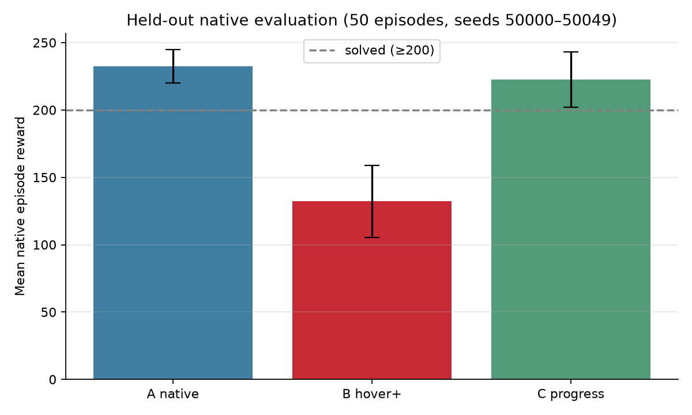
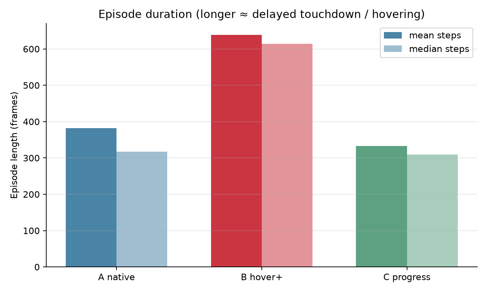

# Simple Gymnasium LunarLander — reward shaping showcase

Train an AI to land a rocket with **Gymnasium `LunarLander-v3`**, **Stable-Baselines3 PPO**, and controlled **reward shaping**.

Based on Hari (@harixganesh): *Training an AI to land a rocket with reward shaping*.

This folder is intentionally small. It does **not** use the R.E.A.C.T. ApolloLander stack (that work remains on other branches/PRs).

---

## Stack

| Piece | Choice |
|-------|--------|
| Env | `LunarLander-v3` (Box2D) |
| Algo | SB3 `PPO("MlpPolicy")`, net `[64, 64]` |
| Obs / actions | 8 floats · Discrete(4) |
| Rendering | Gymnasium `rgb_array` + `RecordVideo` |
| Device | CPU (~4 min × 1M steps) |

**Observations:** x, y, vx, vy, angle, angular velocity, left leg, right leg.  
**Actions:** 0 noop · 1 left engine · 2 main · 3 right engine.

Gymnasium “solved” band: episode **native** score ≥ **200**. That is a **score threshold**, not an independently verified landing count (see Phase 4 table).

---

## Phase 4 result (A / B / C)

Equations: [`REWARD_DEFINITIONS.md`](REWARD_DEFINITIONS.md) · Full audit: [`PHASE4_REPORT.md`](PHASE4_REPORT.md) · Verification: [`VERIFICATION.md`](VERIFICATION.md)

| | **A — native** | **B — hover bonus** | **C — ΔΦ − time** |
|--|--:|--:|--:|
| Train reward | built-in only | native **+1**/frame if `\|angle\|<0.2` and speed`<0.5` | native **+ (Φₜ−Φₜ₋₁) − 0.05** |
| Held-out scoring | **native only** (wrappers off) | same | same |
| Mean native reward (50 eps) | **232.3** ±12.4 | 132.2 ±26.7 | **222.5** ±20.5 |
| Median native | 243.5 | 177.8 | 242.7 |
| Episodes with score ≥200 | **44/50 (88%)** | 10/50 (20%) | **44/50 (88%)** |
| Heuristic pad rests* | 34/50 | 43/50 | 40/50 |
| Mean episode length | 382 | **639** | 333 |
| Episodes ≥800 steps | 4 | **15** | 1 |
| Timeouts (1000 steps) | 3 | 2 | 1 |

\*Heuristic “legs down near pad” — **not** the same as score ≥200. B often eventually touches down after delaying; it is **not** “never lands.”

**Shaped training ≠ native eval.** B’s shaped training return rose (~714 mean during late training) while **native** held-out performance fell. Charts and tables below use **native** scores unless labeled otherwise.

**Takeaways**

- **A:** Built-in potential-style reward teaches finishing the landing.
- **B:** Evidence of **reward misalignment** and **delayed landing** (longer episodes, more ≥800-step runs, weak native scores). Still lands often; do not claim it never lands.
- **C:** Restored **A-like** native performance on this seed; did **not** clearly beat A.

**Limits:** one training seed (`0`) per config · 50 held-out episodes (seeds `50000–50049`) · checkpoint selection used native EvalCallback on seeds `10000+` **before** the held-out test.

### Main charts





More: `outputs/phase4/charts/solved_rate.png`, `native_eval_curves.png`, `timeouts_long.png`, `reward_scatter.png`.

### Gameplay videos (real Gymnasium `RecordVideo`)

| Clip | Path |
|------|------|
| A success | [`videos/phase4_A_success/phase4_A_success_ep0-episode-0.mp4`](videos/phase4_A_success/phase4_A_success_ep0-episode-0.mp4) |
| B delayed / timeout | [`videos/phase4_B_seed50019/B_hover_seed50019-episode-0.mp4`](videos/phase4_B_seed50019/B_hover_seed50019-episode-0.mp4) (~20 s / 1000 frames) |
| B long approach | [`videos/phase4_B_seed50018/B_hover_seed50018-episode-0.mp4`](videos/phase4_B_seed50018/B_hover_seed50018-episode-0.mp4) |
| C success | [`videos/phase4_C_success/C_seed50009-episode-0.mp4`](videos/phase4_C_success/C_seed50009-episode-0.mp4) |

---

## Reproduce

```bash
cd /path/to/R.E.A.C.T
python -m venv .venv && source .venv/bin/activate
pip install -r experiments/simple_lunarlander/requirements.txt

# Phase 1 — random play
python experiments/simple_lunarlander/scripts/random_play.py --episodes 5 --record-episode 0

# Phase 2/4 — train (A/B/C). Prefer loading frozen checkpoints in models/ for review.
python experiments/simple_lunarlander/scripts/train_ppo.py --run-name ppo_baseline --reward-mode native --timesteps 1000000
python experiments/simple_lunarlander/scripts/train_ppo.py --run-name ppo_hover_bad --reward-mode hover_bad --timesteps 1000000
python experiments/simple_lunarlander/scripts/train_ppo.py --run-name ppo_progress_good --reward-mode progress_good --timesteps 1000000

# Held-out native eval (no wrappers)
python experiments/simple_lunarlander/scripts/evaluate_rich.py \
  --label A_baseline_best \
  --model experiments/simple_lunarlander/models/ppo_baseline/best/best_model.zip \
  --episodes 50 --seed-start 50000 \
  --out experiments/simple_lunarlander/outputs/phase4/eval_A_best.json
```

Frozen checkpoints: `models/ppo_*/best/best_model.zip` and `ppo_lunar_final.zip`.

---

## Layout

```
experiments/simple_lunarlander/
  README.md  REWARD_DEFINITIONS.md  PHASE4_REPORT.md  VERIFICATION.md  BASELINE_REPORT.md
  rewards.py  requirements.txt  scripts/
  models/  videos/  outputs/phase4/
```
